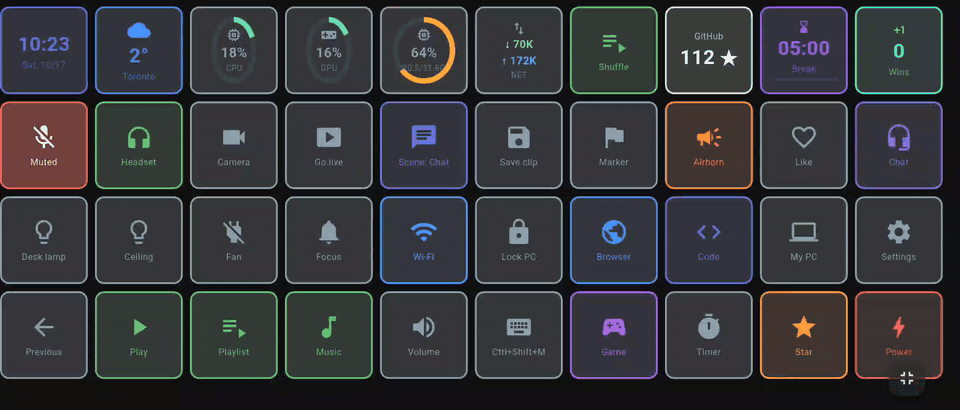
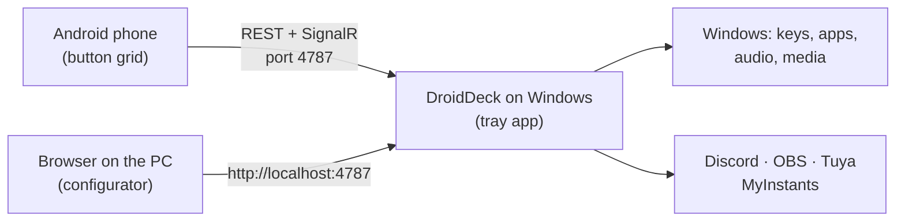

<div align="center">


# DroidDeck

**Turn an Android phone into a Stream Deck for your Windows PC.**

**English** · [Português](README.pt-BR.md)

[](https://github.com/ggfto/DroidDeck/stargazers)
[](https://github.com/ggfto/DroidDeck/releases/latest)
[](https://github.com/ggfto/DroidDeck/releases)
[](https://github.com/ggfto/DroidDeck/actions/workflows/ci.yml)
[](LICENSE)

[**Download**](https://github.com/ggfto/DroidDeck/releases/latest) ·
[**Website**](https://me.gf2.in/DroidDeck/) ·
[**Documentation**](https://me.gf2.in/DroidDeck/docs/)

</div>

> [!NOTE]
> **Looking for the app that runs Steam games on Android?** That is a different project that happens to
> share the name: [Droid-Deck/DroidDeck](https://github.com/Droid-Deck/DroidDeck). This one turns your
> phone into a **button deck that controls a Windows PC**.

---

Set up a grid of buttons on your phone that fire shortcuts, open apps, control audio and media, drive
Discord and OBS, play sounds and switch your smart lights. The PC side is a small tray app; the phone
talks to it over your local network.

<p align="center">
  
</p>

## 💡 Why DroidDeck

- **Free and open source** — no subscription, no limit on the number of buttons or pages.
- **No sign-up, no cloud** — DroidDeck itself needs no account; the phone talks straight to your PC on the local network.
- **Integrations built in** — Discord, OBS, Spotify, Twitch, YouTube, Home Assistant and Tuya work out
  of the box, with live state on the buttons. No plugins to hunt down.
- **Edit on the big screen** — a drag-and-drop configurator in the PC's browser; changes reach the
  phone instantly.
- **Updates itself** — the Windows app installs new versions in the background.

## ✨ Features

| | |
|---|---|
| ⌨️ **Shortcuts & apps** | Send key combinations, open programs, files and URLs, run PowerShell/Python/`.bat` scripts, chain steps in a multi-action (with conditions), call webhooks and APIs. |
| 🪟 **Windows** | Switch the default audio device (headphones ↔ speakers), lock, sleep, turn the screen off. |
| ⏱️ **Timers** | Countdown, stopwatch, pomodoro and counters with a live clock on the button. |
| 🎮 **Steam** | Pick an installed game and the button gets its cover; tap to launch it. |
| 🗂️ **Profiles** | Folders, long-press and double-tap actions, automatic switching by the focused app, `.droiddeck` backups, and an offline copy of the deck on the phone. |
| 🔊 **Audio mixer** | Mute apps, change device volume, toggle the mic. The phone also has a full per-app mixer. |
| ⏯️ **Media** | Play/pause, next, previous for whatever is playing in Windows (Spotify, browser, players). |
| 📊 **Live monitors** | CPU, GPU, RAM and network gauges that update every second. |
| 💬 **Discord** | Mute/deafen, join channels, voice volume, push-to-talk, per-user volume, native soundboard. |
| 🎥 **OBS Studio** | Scenes, recording, streaming, virtual camera, replay buffer, mute and show/hide sources, filters, chapter markers, screenshots — with live state. |
| 🎵 **Soundboard** | Search and play sounds from MyInstants, routed to your mic through VB-Cable. |
| 💡 **Smart home** | Home Assistant, and Tuya / Smart Life lights, plugs and switches — toggles, dimmers and colours, with real state. |
| 🎧 **Spotify** | Player, like, shuffle, playlists and the album cover on the button (Premium). |
| 📡 **Twitch & YouTube** | Markers, clips, ads, polls and chat; live status and viewers. |
| 🔁 **Two states & info** | Toggle buttons with their own icon and label; clock, weather, now playing, Windows notifications, command output and URL values on a button; record macros from the keyboard. |
| 🎚️ **Sliders & big buttons** | Volume sliders for the PC, the mic or one app; buttons that span several cells; animated GIF icons. |
| 🤖 **Automations** | Press a button by itself at a set time, when an app opens or closes, or when the PC wakes up. |
| 📥 **Import & share** | Import Elgato Stream Deck profiles, share a profile by link or QR, start from the [profile gallery](https://me.gf2.in/DroidDeck/gallery/). |
| 🖥️ **Several PCs** | Pair one phone with more than one PC and switch from the deck's top bar. |
| 📱 **iPhone, iPad & USB** | Use the deck in any browser (iPhone, iPad, another PC) through a QR code, or connect an Android phone over a USB cable, no Wi-Fi needed. |
| 🎨 **Themes** | Ready-made themes, light/dark mode, accent colour and three button styles. A "deck only" mode opens straight into a full-screen deck, and buttons can vibrate on tap. |

## 📸 Screenshots

<p align="center">
  
  
</p>
<p align="center">
  
  
</p>

## 🚀 Getting started

**You need both parts:** the Windows app (it does the work) and the Android app (the buttons). The
phone app alone does nothing. On an iPhone or iPad, use the
[deck in the browser](https://me.gf2.in/DroidDeck/docs/getting-started/browser-usb/) instead of the app.

**Requirements:** Windows 10 1809+ (64-bit) · Android 7.0+ (or any browser, for iPhone and iPad) · phone and PC on the same local network, or an Android phone on a USB cable.

1. **Windows** — download and run `DroidDeck-Setup.exe` from the [latest release](https://github.com/ggfto/DroidDeck/releases/latest).
   It lives in the system tray and updates itself. (Prefer no installer? Use `DroidDeck-win-x64.zip`,
   extract it and run `DroidDeck.exe`.) No .NET install needed.
2. **Android** — install `DroidDeck.apk` from the same release.
3. **Pair** — right-click the tray icon → **Parear dispositivo (QR)…** and scan the code with the app.
4. **Configure** — open `http://localhost:4787/` on the PC to edit your buttons. Changes show up on the phone instantly.

> [!NOTE]
> The app follows the phone's language (English, Portuguese, Spanish or Hindi; anything else gets English). The
> [documentation](https://me.gf2.in/DroidDeck/docs/) is available in both.

Having trouble (SmartScreen, firewall, phone not finding the PC)? See
[Installation](https://me.gf2.in/DroidDeck/docs/getting-started/installation/) and
[Troubleshooting](https://me.gf2.in/DroidDeck/docs/troubleshooting/).

## 🔌 Integrations

| Integration | Guide |
|---|---|
| Discord (uses your own Discord app — ~2 min setup) | [Discord](https://me.gf2.in/DroidDeck/docs/integrations/discord/) |
| OBS Studio (obs-websocket) | [OBS Studio](https://me.gf2.in/DroidDeck/docs/integrations/obs/) |
| Soundboard (MyInstants + VB-Cable) | [Soundboard](https://me.gf2.in/DroidDeck/docs/integrations/soundboard/) |
| Tuya / Smart Life (Nova Digital, Positivo, RSmart, Elgin…) | [Smart home](https://me.gf2.in/DroidDeck/docs/integrations/tuya/) |
| Home Assistant (long-lived token) | [Home Assistant](https://me.gf2.in/DroidDeck/docs/integrations/homeassistant/) |
| Spotify (your own Spotify app, Premium) | [Spotify](https://me.gf2.in/DroidDeck/docs/integrations/spotify/) |
| Twitch (your own Twitch app) | [Twitch](https://me.gf2.in/DroidDeck/docs/integrations/twitch/) |
| YouTube (your own Google OAuth client) | [YouTube](https://me.gf2.in/DroidDeck/docs/integrations/youtube/) |
| Streamer.bot (WebSocket Server) | [Streamer.bot](https://me.gf2.in/DroidDeck/docs/integrations/streamerbot/) |
| VTube Studio (plugin API) | [VTube Studio](https://me.gf2.in/DroidDeck/docs/integrations/vtubestudio/) |
| Voicemeeter (Standard, Banana, Potato) | [Voicemeeter](https://me.gf2.in/DroidDeck/docs/integrations/voicemeeter/) |
| Philips Hue (Hue Bridge) | [Philips Hue](https://me.gf2.in/DroidDeck/docs/integrations/hue/) |
| Elgato Key Light | [Elgato Key Light](https://me.gf2.in/DroidDeck/docs/integrations/elgato/) |
| Govee (LAN API) | [Govee](https://me.gf2.in/DroidDeck/docs/integrations/govee/) |
| MQTT (your broker) | [MQTT](https://me.gf2.in/DroidDeck/docs/integrations/mqtt/) |
| Per-app mixer & media | [Mixer & media](https://me.gf2.in/DroidDeck/docs/integrations/mixer-media/) |

## 🧩 How it works



This is a monorepo with both halves of the project, which evolve together:

```
DroidDeck/
  DroidDeck/  C# backend (.NET 8 / WinForms tray + ASP.NET Core + SignalR). Serves the API and the web configurator.
  app/        Flutter app: phone runtime + web configurator (same codebase).
  tests/      Backend tests.
  scripts/    Utilities (deploy the web build to wwwroot).
  website/    Landing page + documentation (MkDocs, EN/PT) published to GitHub Pages.
```

App and backend share a contract: **REST** (`/api/...`), **SignalR** (`/deckHub`) and **UDP discovery**
(port 7573), authenticated with an API key obtained through QR pairing.

## 🛠️ Building from source

```powershell
# Backend: tray app + web server at http://localhost:4787
dotnet run --project DroidDeck

# Web configurator: flutter build web + copy to DroidDeck/wwwroot
.\scripts\deploy-web.ps1

# Android APK
cd app
flutter build apk --debug --target-platform android-arm64
```

Backend modes: default (tray), `--headless` (server only), `--print-pairing` (prints the pairing URI/QR and exits).

Full details — architecture, tests, releases with semantic-release — in
[Architecture](https://me.gf2.in/DroidDeck/docs/developers/architecture/) and
[Building from source](https://me.gf2.in/DroidDeck/docs/developers/building/).

## 🤝 Contributing

Issues and pull requests are welcome; see [CONTRIBUTING.md](CONTRIBUTING.md). Translating the app into
your language is a great first contribution, and questions and ideas go to
[Discussions](https://github.com/ggfto/DroidDeck/discussions).

If DroidDeck is useful to you, consider leaving a ⭐ — it helps the project reach more people.

## ⭐ Star history

<a href="https://star-history.com/#ggfto/DroidDeck&Date">
  <picture>
    <source media="(prefers-color-scheme: dark)" srcset="https://api.star-history.com/svg?repos=ggfto%2Fdroiddeck&type=Date&theme=dark">
    
  </picture>
</a>

## 📄 License

[Apache License 2.0](LICENSE).
