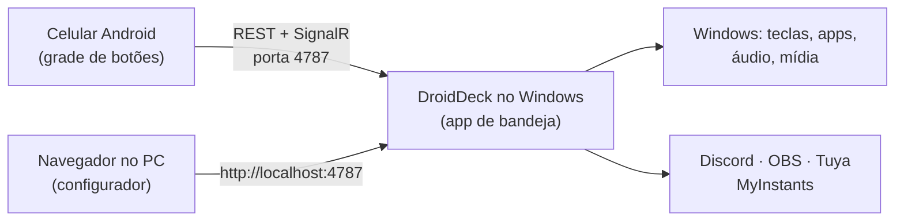

<div align="center">


# DroidDeck

**Transforme um celular Android em um Stream Deck para o seu PC com Windows.**

[English](README.md) · **Português**

[](https://github.com/ggfto/DroidDeck/stargazers)
[](https://github.com/ggfto/DroidDeck/releases/latest)
[](https://github.com/ggfto/DroidDeck/releases)
[](https://github.com/ggfto/DroidDeck/actions/workflows/ci.yml)
[](LICENSE)

[**Baixar**](https://github.com/ggfto/DroidDeck/releases/latest) ·
[**Site**](https://me.gf2.in/DroidDeck/) ·
[**Documentação**](https://me.gf2.in/DroidDeck/docs/pt/)

</div>

> [!NOTE]
> **Procurando o app que roda jogos da Steam no Android?** É outro projeto, que por acaso tem o mesmo
> nome: [Droid-Deck/DroidDeck](https://github.com/Droid-Deck/DroidDeck). Este aqui transforma o celular
> em um **painel de botões que controla um PC com Windows**.

---

Monte uma grade de botões no celular que disparam atalhos, abrem apps, controlam áudio e mídia,
comandam o Discord e o OBS, tocam sons e acendem suas lâmpadas inteligentes. No PC roda um pequeno
app na bandeja do sistema; o celular conversa com ele pela rede local.

<p align="center">
  
</p>

## 💡 Por que o DroidDeck

- **Gratuito e de código aberto** — sem assinatura, sem limite de botões ou páginas.
- **Sem cadastro e sem nuvem** — o DroidDeck não pede conta; o celular fala direto com o seu PC pela rede local.
- **Integrações prontas** — Discord, OBS, Spotify, Twitch, YouTube, Home Assistant e Tuya funcionam de
  fábrica, com o estado ao vivo nos botões. Nada de caçar plugins.
- **Edite na tela grande** — configurador com arrastar e soltar no navegador do PC; as mudanças chegam
  ao celular na hora.
- **Atualiza sozinho** — o app do Windows instala as versões novas em segundo plano.

## ✨ Recursos

| | |
|---|---|
| ⌨️ **Atalhos e apps** | Envie combinações de teclas, abra programas, arquivos e URLs, encadeie passos em uma multiação, chame webhooks e APIs. |
| 🪟 **Windows** | Troque o dispositivo de áudio padrão (fone ↔ caixa de som), trave, suspenda ou desligue a tela. |
| ⏱️ **Timers** | Timer, cronômetro, pomodoro e contadores com o relógio ao vivo no botão. |
| 🎮 **Steam** | Escolha um jogo instalado e o botão ganha a capa dele; um toque abre o jogo. |
| 🗂️ **Perfis** | Pastas, ações de toque longo e toque duplo, troca automática pelo app em foco, backup `.droiddeck` e uma cópia offline do deck no celular. |
| 🔊 **Mixer de áudio** | Silencie apps, ajuste o volume de dispositivos, ligue e desligue o microfone. O celular também tem um mixer completo por app. |
| ⏯️ **Mídia** | Tocar/pausar, próxima e anterior para o que estiver tocando no Windows (Spotify, navegador, players). |
| 📊 **Monitores ao vivo** | Medidores de CPU, GPU, RAM e rede atualizados a cada segundo. |
| 💬 **Discord** | Silenciar/ensurdecer, entrar em canais, volume de voz, push-to-talk, volume por usuário, soundboard nativo. |
| 🎥 **OBS Studio** | Cenas, gravação, transmissão, câmera virtual, replay buffer, silenciar e mostrar/ocultar fontes, filtros, marcadores de capítulo, capturas — com estado ao vivo. |
| 🎵 **Soundboard** | Busque e toque sons do MyInstants, enviados para o seu microfone pelo VB-Cable. |
| 💡 **Casa inteligente** | Home Assistant, e lâmpadas, tomadas e interruptores Tuya / Smart Life — liga/desliga, brilho e cores, com estado real. |
| 🎧 **Spotify** | Player, curtir, aleatório, playlists e a capa do álbum no botão (Premium). |
| 📡 **Twitch e YouTube** | Marcadores, clipes, anúncios, enquetes e chat; ao vivo e espectadores. |
| 🔁 **Dois estados e informação** | Botões liga/desliga com ícone e rótulo próprios; relógio, clima, tocando agora, saída de comando e valores de URL no botão; macros gravadas pelo teclado. |
| 🖥️ **Vários PCs** | Um celular pareado com mais de um PC, trocando pela barra do deck. |
| 🎨 **Temas** | Temas prontos, modo claro/escuro, cor de destaque e três estilos de botão. O modo "só o deck" abre direto no deck em tela cheia, e os botões podem vibrar ao tocar. |

## 📸 Capturas de tela

<p align="center">
  
  
</p>
<p align="center">
  
  
</p>

## 🚀 Começando

**Você precisa das duas partes:** o app do Windows (que executa as ações) e o app Android (os
botões). Só o app do celular não faz nada.

**Requisitos:** Windows 10 1809+ (64 bits) · Android 7.0+ · celular e PC na mesma rede local.

1. **Windows** — baixe e rode o `DroidDeck-Setup.exe` da [versão mais recente](https://github.com/ggfto/DroidDeck/releases/latest).
   Ele fica na bandeja do sistema e se atualiza sozinho. (Prefere sem instalar? Use o `DroidDeck-win-x64.zip`,
   descompacte e rode o `DroidDeck.exe`.) Não precisa instalar o .NET.
2. **Android** — instale o `DroidDeck.apk` da mesma release.
3. **Parear** — clique com o botão direito no ícone da bandeja → **Parear dispositivo (QR)…** e escaneie o código com o app.
4. **Configurar** — abra `http://localhost:4787/` no PC para editar seus botões. As mudanças aparecem no celular na hora.

Algum problema (SmartScreen, firewall, celular não encontra o PC)? Veja
[Instalação](https://me.gf2.in/DroidDeck/docs/pt/getting-started/installation/) e
[Solução de problemas](https://me.gf2.in/DroidDeck/docs/pt/troubleshooting/).

## 🔌 Integrações

| Integração | Guia |
|---|---|
| Discord (usa o seu próprio app do Discord — setup de ~2 min) | [Discord](https://me.gf2.in/DroidDeck/docs/pt/integrations/discord/) |
| OBS Studio (obs-websocket) | [OBS Studio](https://me.gf2.in/DroidDeck/docs/pt/integrations/obs/) |
| Soundboard (MyInstants + VB-Cable) | [Soundboard](https://me.gf2.in/DroidDeck/docs/pt/integrations/soundboard/) |
| Tuya / Smart Life (Nova Digital, Positivo, RSmart, Elgin…) | [Casa inteligente](https://me.gf2.in/DroidDeck/docs/pt/integrations/tuya/) |
| Home Assistant (token de longa duração) | [Home Assistant](https://me.gf2.in/DroidDeck/docs/pt/integrations/homeassistant/) |
| Spotify (seu próprio app do Spotify, Premium) | [Spotify](https://me.gf2.in/DroidDeck/docs/pt/integrations/spotify/) |
| Twitch (seu próprio app da Twitch) | [Twitch](https://me.gf2.in/DroidDeck/docs/pt/integrations/twitch/) |
| YouTube (seu próprio cliente OAuth do Google) | [YouTube](https://me.gf2.in/DroidDeck/docs/pt/integrations/youtube/) |
| Mixer por app e mídia | [Mixer e mídia](https://me.gf2.in/DroidDeck/docs/pt/integrations/mixer-media/) |

## 🧩 Como funciona



Monorepo com as duas metades do projeto, que evoluem juntas:

```
DroidDeck/
  DroidDeck/  Backend C# (.NET 8 / WinForms tray + ASP.NET Core + SignalR). Serve a API e o configurador web.
  app/        App Flutter: runtime no celular + configurador web (mesmo código).
  tests/      Testes do backend.
  scripts/    Utilitários (deploy do web para o wwwroot).
  website/    Landing page + documentação (MkDocs, EN/PT) publicadas no GitHub Pages.
```

O app e o backend compartilham um contrato: **REST** (`/api/...`), **SignalR** (`/deckHub`) e
**discovery UDP** (porta 7573), autenticados por uma API key obtida no pareamento por QR.

## 🛠️ Compilando do código-fonte

```powershell
# Backend: app de bandeja + servidor web em http://localhost:4787
dotnet run --project DroidDeck

# Configurador web: flutter build web + copia para DroidDeck/wwwroot
.\scripts\deploy-web.ps1

# APK Android
cd app
flutter build apk --debug --target-platform android-arm64
```

Modos do backend: padrão (bandeja), `--headless` (só servidor), `--print-pairing` (imprime a URI/QR de pareamento e sai).

Detalhes completos — arquitetura, testes, releases com semantic-release — em
[Arquitetura](https://me.gf2.in/DroidDeck/docs/pt/developers/architecture/) e
[Compilando do código-fonte](https://me.gf2.in/DroidDeck/docs/pt/developers/building/).

## 🤝 Contribuindo

Issues e pull requests são bem-vindos; veja o [CONTRIBUTING.md](CONTRIBUTING.md) (em inglês). Traduzir o
app para outro idioma é uma ótima primeira contribuição, e dúvidas e ideias vão para as
[Discussions](https://github.com/ggfto/DroidDeck/discussions).

Se o DroidDeck te ajuda, deixe uma ⭐ — isso ajuda o projeto a chegar em mais gente.

## ⭐ Histórico de estrelas

<a href="https://star-history.com/#ggfto/DroidDeck&Date">
  <picture>
    <source media="(prefers-color-scheme: dark)" srcset="https://api.star-history.com/svg?repos=ggfto%2Fdroiddeck&type=Date&theme=dark">
    
  </picture>
</a>

## 📄 Licença

[Apache License 2.0](LICENSE).
