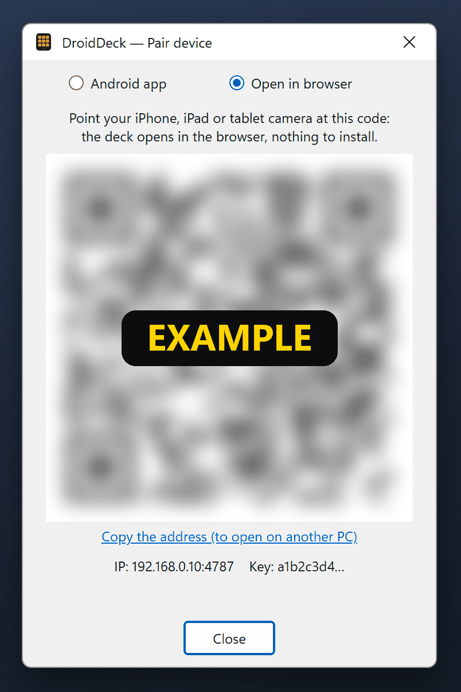

# Browser & USB

Besides the Android app over Wi-Fi, there are two other ways to use the deck: in a **browser** on any
device (iPhone, iPad, another PC) and over a **USB cable** with an Android phone.

## Deck in the browser { #browser }

The PC serves the deck itself, so an iPhone, an iPad, a tablet or another computer on the same network
can use it from the browser, without installing anything.

1. On the PC, right-click the tray icon → **Pair device (QR)…**: the pairing window opens.
2. At the top of the window, pick **Open in browser**. The QR code changes.
3. Point the device's camera at the code and open the link.

<figure class="dd-figure" markdown>
{ .dd-shot width="402" height="602" loading="lazy" }
<figcaption>Open in browser mode. An example: the code is blurred, and the address and key are made up.</figcaption>
</figure>

The deck opens with your buttons. The link carries the API key: the page saves it in the browser and
removes it from the address bar, so the address you see (and bookmark) no longer has it.

- **No camera?** Open `http://<PC IP>:4787/` on the device and type the **key** shown at the bottom of
  the pairing window. **Copy the address (to open on another PC)** in the same window copies the full link,
  handy for opening the deck on another PC.
- **Grid**: the browser uses the same grid as your phone, so the buttons are in the same places. If no
  phone has connected yet, it uses the default 3 × 5 grid.
- **Full screen**: the full-screen button in the bottom-right corner hides the browser's bars (on
  Android and desktop browsers).
- **iPhone and iPad**: Safari has no full-screen mode for pages. Use **Share → Add to Home Screen**: the
  deck gets its own icon and opens without the address bar, like an app.
- **On the PC itself**: `http://localhost:4787/?deck` opens the deck view instead of the configurator,
  with no pairing needed.
- To unpair a browser, open **Settings** in the deck and tap **Forget**. If the PC's key
  changes, the page asks you to pair again.

!!! info "Same rules as the phone"
    The browser deck behaves like the Android app: it runs every button, but buttons with
    [privileged actions](../guide/actions.md) (keyboard shortcut, open program, script, HTTP request) can only be
    created or changed in the configurator on the PC itself. The page is plain HTTP on your local network,
    like the app's connection.

## USB cable (Android) { #usb }

With a USB cable, the phone talks to the PC through the cable instead of the network. It works with no
Wi-Fi at all, on networks that isolate devices from each other and with the firewall closed, and has a
little less latency.

1. On the phone, turn on **USB debugging** (Android Settings → Developer options). If you don't see
   Developer options, tap **Build number** seven times under **About phone**.
2. On the PC, right-click the tray icon → **USB connection (cable)**.
    - If the Android SDK is already installed on the PC (its `adb` is found in `ANDROID_HOME`, the SDK's
      default folder or `PATH`), the option is already on.
    - Otherwise DroidDeck asks before downloading Google's official **platform-tools** (about 7 MB) to
      `%LocalAppData%\DroidDeck\platform-tools`. Nothing is downloaded without your OK.
3. Plug in the cable and accept the **Allow USB debugging?** prompt on the phone.

The tray item shows the status: *USB connection (cable): waiting for phone* or *USB connection (cable):
1 phone connected*. Behind the scenes DroidDeck runs `adb reverse` for port 4787 every few seconds, so
`127.0.0.1:4787` on the phone reaches the PC.

The phone must already be [paired](pairing.md) with this PC. When it connects, the app tries the cable
first and uses it only if the PC on the other end accepts its key, so plugging into a different PC
doesn't switch your paired PC. When you unplug the cable, it goes back to the network address.

To turn it off, click **USB connection (cable)** again.

!!! warning "USB is not the PC itself"
    A connection through the cable reaches the server as `127.0.0.1`, but DroidDeck checks that it comes
    from `adb` and treats it like any other phone: it does **not** count as the PC for privileged actions
    or the configurator's automatic sign-in. While the cable is forwarding, any app on the phone can
    reach `127.0.0.1:4787` on it — it still needs the API key to do anything.
