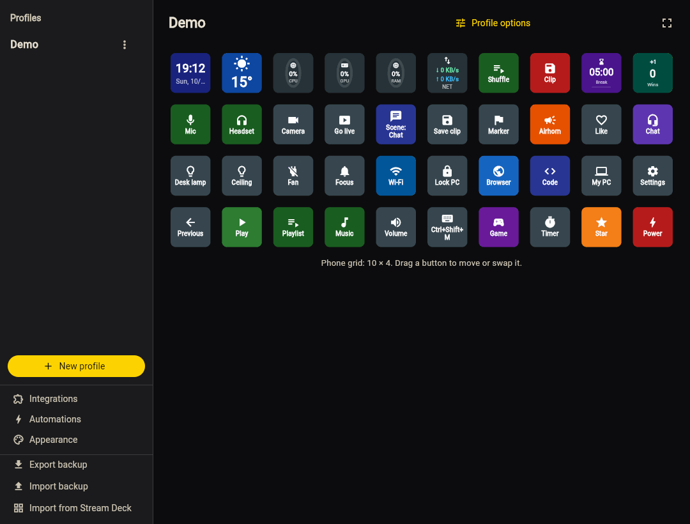

---
hide:
  - toc
---

# Your first button

With the phone [paired](pairing.md) (the chip at the top of the deck reads **Connected to** your PC), make a button that plays and pauses whatever is playing on the
PC. It takes about a minute and shows the whole loop: edit on the PC, tap on the phone.

## 1. Open the configurator

On the PC, right-click the DroidDeck tray icon → **Open in browser** (or double-click the icon).
The [configurator](configurator.md) opens at `http://localhost:4787/` and signs in by itself.

<figure class="dd-figure dd-figure--wide" markdown>
[{ .dd-shot width="1080" height="820" loading="lazy" }](../../assets/screenshots/configurator-en.png)
<figcaption>The configurator with the demo profile: <strong>Profiles</strong> on the left and the
<strong>grid</strong> of buttons in the middle. A third panel on the right holds the selected button's
<strong>properties</strong>. Click the image to see the whole window.</figcaption>
</figure>

Until you select a button, the right panel is a short guide:

<figure class="dd-figure" markdown>
{ .dd-shot width="359" height="280" loading="lazy" }
<figcaption>The right panel, actual size. Clicking a cell replaces this guide with the button's properties.</figcaption>
</figure>

## 2. Add the button

1. Click an **empty cell** in the grid. The properties panel shows a new button.
2. Under **Action**, choose **Media**.
3. Leave **Command** on **Play / Pause**. You can leave **Label** empty: media buttons fill it in.
4. Click **Save**.

The button appears on the phone right away; there is nothing to sync.

## 3. Tap it on the phone

Start some music or a video on the PC (Spotify, YouTube in a browser, any player) and tap the new
button on the phone. Playback pauses, and the icon switches between ▶ and ⏸ to match.

That's the whole loop. Buttons that have an on and off state light up when they're on, like these:

<figure class="dd-figure" markdown>
{ .dd-shot width="460" height="278" loading="lazy" }
<figcaption>The demo profile in use: buttons light up and change their label as they switch on.</figcaption>
</figure>

!!! tip "Prefer to edit on the phone?"
    Tap an empty cell on the phone to create a button there, and long-press a button to edit it.
    Buttons that send keys, open programs or run scripts can only be created on the PC; see
    [Configurator](configurator.md#editing-on-the-phone).

## What next

- [Buttons & actions](../guide/actions.md): every action type, from keyboard shortcuts to timers.
- [Integrations](../guide/actions.md#streaming): Discord, OBS, Spotify, smart lights and more.
- [Automations](../guide/automations.md): buttons that press themselves at a time or when an app opens.
- [Import from Stream Deck](../guide/import-share.md#stream-deck): bring your Elgato profiles over.
- [Profile gallery](https://me.gf2.in/DroidDeck/gallery/): ready-made decks to start from.
