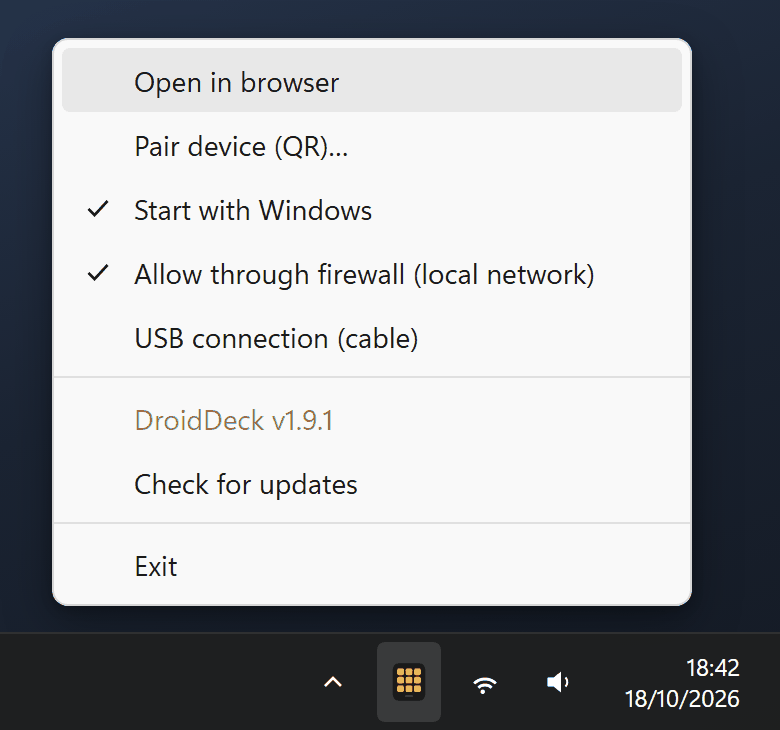

# Installation

## You need both parts

<div class="dd-parts" markdown>

<div class="dd-part" markdown>
<p class="dd-part__text"><strong>1. DroidDeck for Windows</strong> runs the actions on your PC. It lives in the system tray.</p>

[:material-microsoft-windows: Windows app](https://github.com/ggfto/DroidDeck/releases/latest/download/DroidDeck-Setup.exe){ .md-button .md-button--primary }
</div>

<div class="dd-part" markdown>
<p class="dd-part__text"><strong>2. DroidDeck for Android</strong> is the deck: the buttons you tap. Download it on the phone.</p>

[:material-android: Android app](https://github.com/ggfto/DroidDeck/releases/latest/download/DroidDeck.apk){ .md-button .md-button--primary }
</div>

</div>

Both files are also attached to every [GitHub release](https://github.com/ggfto/DroidDeck/releases/latest).
No iPhone app? The deck also runs in [any browser](browser-usb.md#browser).

## Windows

1. Download **`DroidDeck-Setup.exe`**.

    [:material-download: Download DroidDeck-Setup.exe](https://github.com/ggfto/DroidDeck/releases/latest/download/DroidDeck-Setup.exe){ .md-button .md-button--primary }

2. Run it. It installs for the current user (no administrator needed) and adds desktop and Start
   menu shortcuts.

    !!! note "Windows protected your PC?"
        It's safe to run: the installer isn't code-signed yet, so Windows SmartScreen may show
        *"Windows protected your PC"*. Click **More info → Run anyway**.

3. On first run, DroidDeck turns on **Start with Windows** and offers to open the
   [firewall](#firewall) for your local network. Say yes, so the phone can reach the PC.

The app has no window. It lives in the **system tray** (it may be behind the **^** arrow), and a
notification confirms it is running at `http://localhost:4787/`. The build is self-contained, so you
don't need to install .NET.

The installed DroidDeck **updates itself**: it checks the GitHub releases, downloads new versions in
the background and applies them the next time it starts. To update right away, use **Check for
updates** in the tray menu. To uninstall, use Windows *Settings → Apps*.

??? note "Rather not install?"
    The release also has **`DroidDeck-win-x64.zip`**. Extract it to a permanent folder and run
    `DroidDeck.exe`. That copy doesn't update itself: the tray item **Download the latest version…**
    opens the release page.

## Android

1. On the phone, download **`DroidDeck.apk`**.

    [:material-download: Download DroidDeck.apk](https://github.com/ggfto/DroidDeck/releases/latest/download/DroidDeck.apk){ .md-button .md-button--primary }

2. Open it and allow installing from unknown sources when Android asks.
3. Open **DroidDeck** and continue with [Pairing](pairing.md).

Android 7.0 or later is required. The app needs the camera only to scan pairing QR codes.

**Next: [pair the phone with the PC](pairing.md).**

## Tray menu

Right-click the DroidDeck icon in the system tray (it may be behind the **^** arrow):

<figure class="dd-figure" markdown>
{ .dd-shot width="440" height="412" loading="lazy" }
<figcaption>The tray menu. Ticks show the options that are on.</figcaption>
</figure>

??? note "What each tray item does"

    | Item | What it does |
    |---|---|
    | **Open in browser** | Opens the configurator at `http://localhost:4787/` (double-clicking the icon does the same). |
    | **Pair device (QR)…** | Shows the pairing QR code for the phone. |
    | **Start with Windows** | Starts DroidDeck when you sign in to Windows. |
    | **Allow through firewall (local network)** | Adds the [firewall](#firewall) rules. Ticked when they already exist. |
    | **USB connection (cable)** | Connects an Android phone over a [USB cable](browser-usb.md#usb). |
    | **Check for updates** | Checks for a new version; once one is downloaded it becomes **Restart to update**. |
    | **Exit** | Quits DroidDeck. |

## Firewall

The phone connects to the PC on **TCP 4787**, and automatic server discovery uses **UDP 7573**.
The installer offers to open both on first run. If you skipped it, use the tray item
**Allow through firewall (local network)**. Windows asks for administrator permission, and the rules
only accept devices on your local subnet, even if the Wi-Fi is marked as a Public network.

??? note "Add the rules by hand"
    In an elevated PowerShell:

    ```powershell
    New-NetFirewallRule -DisplayName "DroidDeck (TCP 4787)" -Direction Inbound -Protocol TCP -LocalPort 4787 -RemoteAddress LocalSubnet -Action Allow
    New-NetFirewallRule -DisplayName "DroidDeck discovery (UDP 7573)" -Direction Inbound -Protocol UDP -LocalPort 7573 -RemoteAddress LocalSubnet -Action Allow
    ```
