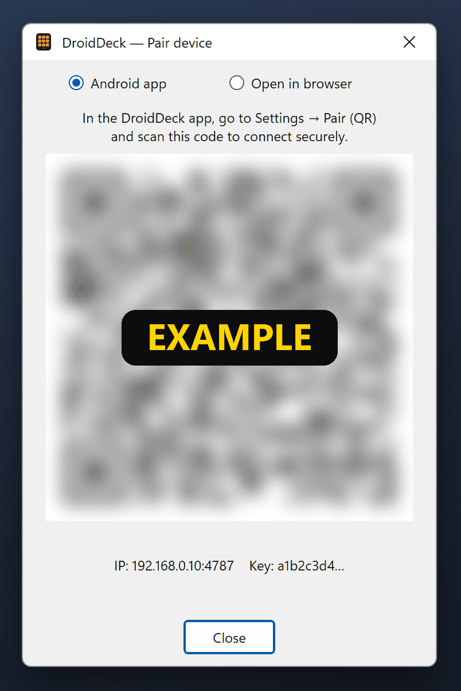

# Pairing

Pairing gives the phone the PC's address and a secret **API key**. You only do it once.

## Pair with a QR code (recommended)

1. On the PC, right-click the tray icon and choose **Pair device (QR)…**: the pairing window opens
   with **Android app** selected.
2. On the phone, open DroidDeck. On first launch the **settings** screen opens; otherwise tap the
   gear on the **Audio** tab.
3. Tap **Pair (QR)** and scan the code.

<figure class="dd-figure" markdown>
<figcaption>Example only: the code is blurred on purpose. Your window shows a sharp code, with your
PC's address and key under it.</figcaption>
{ .dd-shot width="402" height="602" loading="lazy" }
</figure>

### You're connected

The status chip in the deck's top bar turns green and reads:

:material-link-variant: Connected to GAMING-PC

with your PC's name instead of *GAMING-PC* (over a USB cable the icon is a plug). The phone saves the
address, port and key, and reconnects by itself from now on. If it says **Reconnecting…** or
**PC offline** instead, see [If the phone doesn't connect](#if-the-phone-doesnt-connect).

Next: [make your first button](first-button.md).

??? info "What is inside the QR code"
    `droiddeck://pair?ip=<LAN IP>&port=4787&key=<api key>`: the PC's LAN address, the port and the
    API key. Treat it like a password. Anyone who scans it can control your PC through DroidDeck.

!!! tip "iPhone, iPad or no Wi-Fi?"
    Pick **Open in browser** at the top of the same window for a QR code that opens the deck in any
    browser. An Android phone can also connect over a USB cable. See [Browser & USB](browser-usb.md).

## If the phone doesn't connect

- Check that the phone and the PC are on the **same network**, and that the tray item
  **Allow through firewall (local network)** is ticked.
- If the phone shows *"Authentication failed (invalid or expired key). Pair again."*, scan the QR
  code again.
- More fixes in [Troubleshooting](../troubleshooting.md).

## Other ways to connect

### Find the server automatically

**Search for server** broadcasts on the local network (UDP 7573) and fills in the PC's IP address.
Discovery does **not** send the API key, so you still need to pair with the QR code before the phone
can connect.

### Enter the address manually

Type the PC's IP in **Server IP** (`192.168.0.10` or `192.168.0.10:4787`) and tap **Save**.
An API key from an earlier pairing is kept.

## Resetting the key

The key is stored on the PC in `%LocalAppData%\DroidDeck\apikey`. To revoke access for every paired
phone, quit DroidDeck, delete that file and start it again. A new key is generated, and every phone
must pair again.

??? note "Connection behaviour"
    The phone reconnects by itself if the PC restarts or the Wi-Fi drops. It retries quickly at first
    (0, 2, 5, 10, 20 s) and then every 30 s, indefinitely. Tap the status chip to see what to do and,
    under **Technical details**, the connection URL (with the key masked) and the last data received.
