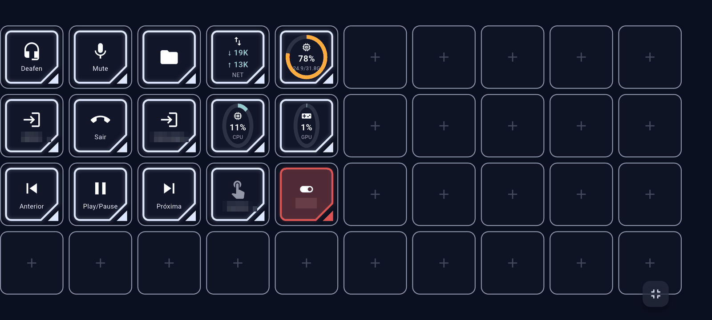
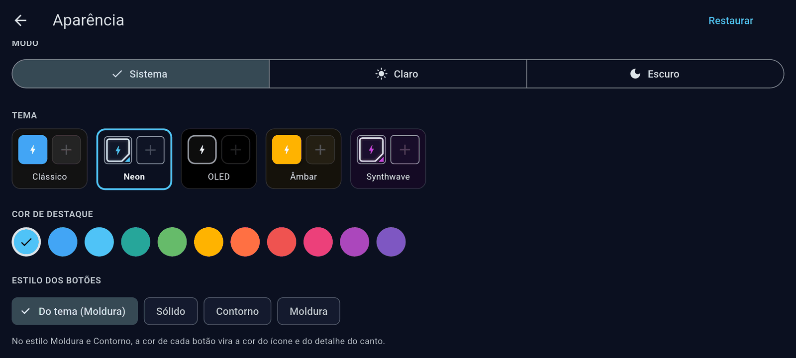
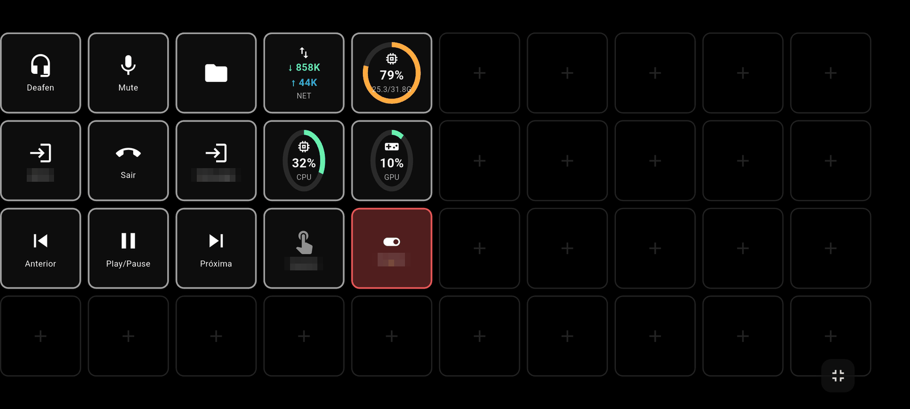
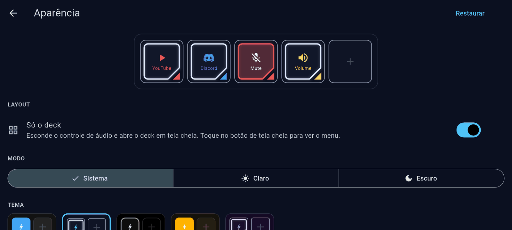

# Appearance

The phone app has its own look settings, under **⚙️ Configuração → Aparência**. Changes apply right away and
are saved on the phone, so each phone can have a different look.

## Themes

A theme sets the background, colours and button style of the whole app in one tap:

| Theme | Look |
|---|---|
| **Clássico** | Dark grey with blue, solid buttons (the original look). |
| **Neon** | Navy blue, double frame with a cut corner. |
| **OLED** | Pure black with outlined buttons. Saves battery on OLED screens. |
| **Âmbar** | Warm dark tones with amber, solid buttons. |
| **Synthwave** | Deep purple with magenta, double frame. |

On top of the theme you can change:

- **Modo** (mode) — *Sistema* follows the phone's light/dark setting; *Claro* (light) and *Escuro*
  (dark) force one. The themes above describe the dark look; the light one is derived from the accent
  colour.
- **Cor de destaque** (accent colour) — the colour of switches, links and highlights. *Do tema* keeps
  the theme's own.
- **Estilo dos botões** (button style) — *Sólido* (filled with the button's colour), *Contorno* (border
  in the button's colour) or *Moldura* (double frame with a coloured corner). *Do tema* keeps the theme's
  own.

In the *Contorno* and *Moldura* styles the colour you pick for a button in the configurator becomes the
colour of its icon and corner instead of its fill. Neutral colours, like the editor's default grey, stay
white.

## Deck only

**Só o deck** hides the audio tab: the app opens straight into the deck, in full screen, with no tabs
at the bottom. Handy for a phone that sits on the desk as a dedicated deck.

To reach the settings again, tap the full-screen button in the bottom-right corner: the top bar comes
back with the **⚙️** button.

**Restaurar** in the top-right corner of the Aparência screen goes back to the default theme.
