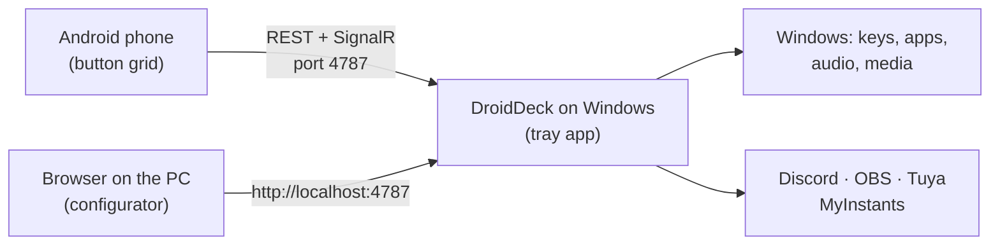

# DroidDeck

**DroidDeck turns an Android phone into a Stream Deck for your Windows PC.** Set up a grid of buttons
on your phone that fire shortcuts, open apps, control audio and media, drive Discord and OBS, play
sounds, and switch your smart lights. The PC side is a small tray app; the phone talks to it over your
local network.

!!! info "Looking for the Steam-on-Android app?"
    That is a different project that shares the name:
    [Droid-Deck/DroidDeck](https://github.com/Droid-Deck/DroidDeck). This DroidDeck is a button deck
    that controls a Windows PC.

[Download the latest release :material-download:](https://github.com/ggfto/DroidDeck/releases/latest){ .md-button .md-button--primary }
[Get started](getting-started/installation.md){ .md-button }

## What you can do

| | |
|---|---|
| :material-keyboard: **Shortcuts & apps** | Send key combinations, open programs, files and URLs, run PowerShell/Python/`.bat` scripts, call webhooks, chain steps in a multi-action with conditions. |
| :material-microsoft-windows: **Windows** | Switch the default audio device, lock the PC, sleep, turn the screen off. |
| :material-volume-high: **Audio mixer** | Mute apps, change device volume, toggle the mic. The phone also has a full per-app mixer. |
| :material-play-pause: **Media** | Play/pause, next, previous for whatever is playing in Windows (Spotify, browser, players). |
| :material-chart-donut: **Live monitors** | CPU, GPU, RAM and network gauges that update every second. |
| :simple-discord: **Discord** | Mute/deafen, join channels, voice volume, push-to-talk, per-user volume, native soundboard. |
| :simple-obsstudio: **OBS Studio** | Scenes, recording, streaming, virtual camera, replay buffer, sources, filters and screenshots, with live state. |
| :material-timer-outline: **Timers** | Countdown, stopwatch, pomodoro and counters with a live clock on the button. |
| :simple-steam: **Steam** | Pick an installed game and the button gets its cover; tap to launch it. |
| :material-folder-multiple: **Profiles** | Folders, long-press and double-tap actions, automatic switching by the focused app, backups, and an offline copy of the deck. |
| :material-music-box-multiple: **Soundboard** | Search and play sounds from MyInstants, routed to your mic through VB-Cable. |
| :material-lightbulb-on: **Smart home** | Home Assistant, and Tuya / Smart Life lights, plugs and switches — toggles, dimmers and colours, with real state. |
| :simple-spotify: **Spotify** | Player, like, shuffle, playlists and the album cover on the button (Premium). |
| :simple-twitch: **Twitch & YouTube** | Markers, clips, ads, polls and chat; live status and viewers. |
| :material-toggle-switch: **Two states & info** | Toggle buttons with their own icon and label, plus clock, weather, now playing, Windows notifications, command output and URL values. |
| :material-tune-vertical: **Sliders & big buttons** | Volume sliders for the PC, the mic or one app; buttons that span several cells; animated GIF icons. |
| :material-puzzle: **More integrations** | [Streamer.bot](integrations/streamerbot.md), [VTube Studio](integrations/vtubestudio.md), [Voicemeeter](integrations/voicemeeter.md), [Philips Hue](integrations/hue.md), [Elgato Key Light](integrations/elgato.md), [Govee](integrations/govee.md) and [MQTT](integrations/mqtt.md), on your local network. |
| :material-robot: **Automations** | Press a button by itself at a time, when an app opens or closes, or when the PC wakes. |
| :material-import: **Import & share** | Import Elgato Stream Deck profiles, share a profile by link or QR, start from the profile gallery. |
| :material-cellphone-link: **Any device** | Use the deck in a browser on an iPhone, iPad or another PC, or connect an Android phone over USB without Wi-Fi. |

## How it works

1. **DroidDeck for Windows** runs in the system tray and serves an API and the web configurator on port `4787`.
2. **The Android app** pairs once by scanning a QR code, then shows your buttons full screen.
3. **The configurator** runs in the PC's browser: drag buttons around, pick actions, colours and icons.
   Changes appear on the phone immediately.

## Requirements

- Windows 10 version 1809 or later (64-bit). No .NET installation needed.
- Android 7.0 or later — or, through the [browser](getting-started/browser-usb.md#browser), an iPhone,
  iPad or any device with a modern browser.
- Phone and PC on the same local network, or an Android phone on a [USB cable](getting-started/browser-usb.md#usb).

!!! note "Language"
    The app follows the phone's language (English, Portuguese or Spanish); you can change it under
    **Settings → Appearance → Language**. This documentation is available in English and Portuguese —
    use the language selector at the top.
