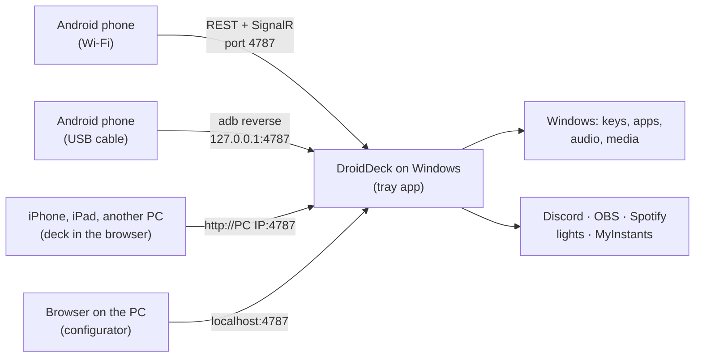

# DroidDeck

**DroidDeck turns an Android phone into a Stream Deck for your Windows PC.** Set up a grid of buttons
on your phone that fire shortcuts, open apps, control audio and media, drive Discord and OBS, play
sounds and switch your smart lights. The PC side is a small tray app; the phone talks to it over your
local network.

You need both parts:

[:material-microsoft-windows: 1. Windows app](https://github.com/ggfto/DroidDeck/releases/latest/download/DroidDeck-Setup.exe){ .md-button .md-button--primary }
[:material-android: 2. Android app](https://github.com/ggfto/DroidDeck/releases/latest/download/DroidDeck.apk){ .md-button .md-button--primary }
[Installation guide](getting-started/installation.md){ .md-button }

<figure class="dd-figure dd-figure--wide" markdown>
{ .dd-shot width="960" height="410" }
</figure>

!!! info "Looking for the Steam-on-Android app?"
    That is a different project that shares the name:
    [Droid-Deck/DroidDeck](https://github.com/Droid-Deck/DroidDeck). This DroidDeck is a button deck
    that controls a Windows PC.

## What you can do

-   :material-keyboard: **Run things on the PC**

    Key combinations, programs, files and URLs, PowerShell/Python/`.bat` scripts, webhooks, Steam
    games, and Windows itself: default audio device, lock, sleep, screen off.
    [Buttons & actions](guide/actions.md) · [Multi-action](guide/multi-action.md)

-   :material-volume-high: **Audio and media**

    Play/pause and skip whatever Windows is playing, mute apps, volume sliders, Spotify with the album
    cover, Voicemeeter, and a MyInstants soundboard into your mic.
    [Mixer & media](integrations/mixer-media.md) · [Soundboard](integrations/soundboard.md)

-   :simple-obsstudio: **Streaming**

    Discord voice and soundboard, OBS scenes, recording and streaming with live state, Twitch and
    YouTube markers, clips, polls and chat, Streamer.bot and VTube Studio.
    [Discord](integrations/discord.md) · [OBS](integrations/obs.md)

-   :material-lightbulb-on: **Lights and smart home**

    Tuya / Smart Life, Home Assistant, Philips Hue, Elgato Key Light, Govee and MQTT: toggles,
    dimmers and colours, with the real state on the button.
    [Tuya](integrations/tuya.md) · [Home Assistant](integrations/homeassistant.md)

-   :material-chart-donut: **Live information**

    CPU, GPU, RAM and network gauges, clock, weather, now playing, Windows notifications, AI usage,
    sliders, timers and pomodoro, two-state toggles, big buttons and animated GIF icons.
    [Monitors & info](guide/monitors.md) · [Appearance](guide/appearance.md)

-   :material-folder-multiple: **Profiles and automation**

    Folders, long-press and double-tap, switching by the focused app, automations, Stream Deck
    import, sharing by link or QR, and the deck in any browser or over USB.
    [Profiles](guide/profiles.md) · [Automations](guide/automations.md)

## How it works

1. **DroidDeck for Windows** runs in the system tray and serves an API, the web configurator and the
   browser deck on port `4787`.
2. **The Android app** pairs once by scanning a QR code, then shows your buttons full screen, over
   Wi-Fi or a [USB cable](getting-started/browser-usb.md#usb).
3. **The configurator** runs in the PC's browser: drag buttons around, pick actions, colours and icons.
   Changes appear on the phone immediately.

## Requirements

- Windows 10 version 1809 or later (64-bit). No .NET installation needed.
- Android 7.0 or later. Or, through the [browser](getting-started/browser-usb.md#browser), an iPhone,
  iPad or any device with a modern browser.
- Phone and PC on the same local network, or an Android phone on a [USB cable](getting-started/browser-usb.md#usb).

!!! note "Language"
    The app follows the phone's language (English, Portuguese or Spanish); you can change it under
    **Settings → Appearance → Language**. This documentation is in English and Portuguese (use the
    language selector at the top); there is no Spanish version yet.
