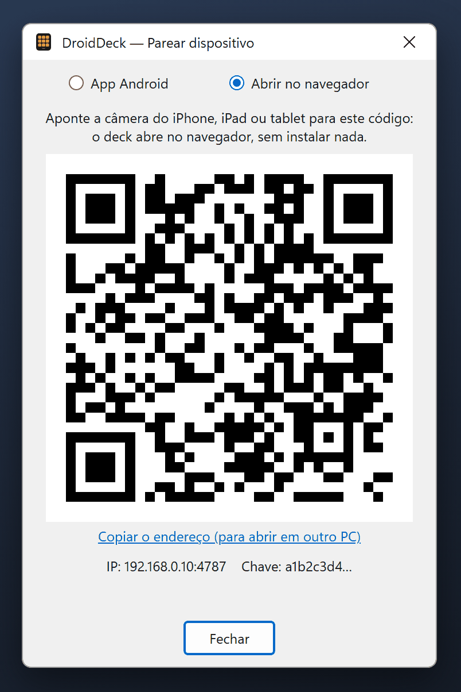

# Navegador e USB

Além do app Android pelo Wi-Fi, há outros dois jeitos de usar o deck: num **navegador** em qualquer
aparelho (iPhone, iPad, outro PC) e pelo **cabo USB** com um celular Android.

## Deck no navegador { #browser }

O próprio PC serve o deck, então um iPhone, um iPad, um tablet ou outro computador da mesma rede pode
usá-lo pelo navegador, sem instalar nada.

1. No PC, clique com o botão direito no ícone da bandeja → **Parear dispositivo (QR)…**.
2. No topo da janela, escolha **Abrir no navegador**. O QR code muda.
3. Aponte a câmera do aparelho para o código e abra o link.

<figure class="dd-figure" markdown>
{ .dd-shot width="402" height="602" loading="lazy" }
<figcaption>Modo Abrir no navegador. O endereço e a chave são exemplos.</figcaption>
</figure>

O deck abre com os seus botões. O link leva a chave de API: a página a guarda no navegador e a tira da
barra de endereço, então o endereço que aparece (e que você salva nos favoritos) já não tem a chave.

- **Sem câmera?** Abra `http://<IP do PC>:4787/` no aparelho e digite a **chave** mostrada embaixo na
  janela de pareamento. **Copiar o endereço**, na mesma janela, copia o link completo, prático para
  abrir o deck em outro PC.
- **Grade**: o navegador usa a mesma grade do seu celular, então os botões ficam nos mesmos lugares. Se
  nenhum celular se conectou ainda, ele usa a grade padrão de 3 × 5.
- **Tela cheia**: o botão de tela cheia no canto inferior direito esconde as barras do navegador (no
  Android e nos navegadores de computador).
- **iPhone e iPad**: o Safari não tem tela cheia para páginas. Use **Compartilhar → Adicionar à Tela de
  Início**: o deck ganha um ícone próprio e abre sem a barra de endereço, como um app.
- **No próprio PC**: `http://localhost:4787/?deck` abre o deck em vez do configurador, sem precisar
  parear.
- Para desparear um navegador, abra a **Configuração** no deck e toque em **Esquecer**. Se a chave do PC
  mudar, a página pede para parear de novo.

!!! info "As mesmas regras do celular"
    O deck no navegador se comporta como o app Android: executa todos os botões, mas botões com
    [ações privilegiadas](../guide/actions.md) (atalho de teclado, abrir programa, script, requisição HTTP) só
    podem ser criados ou alterados no configurador do próprio PC. A página usa HTTP simples na sua rede
    local, como a conexão do app.

## Cabo USB (Android) { #usb }

Com um cabo USB, o celular fala com o PC pelo cabo em vez da rede. Funciona sem Wi-Fi nenhum, em redes
que isolam os aparelhos entre si e com o firewall fechado, e tem um pouco menos de atraso.

1. No celular, ligue a **Depuração USB** (Configurações do Android → Opções do desenvolvedor). Se não
   aparecerem as Opções do desenvolvedor, toque sete vezes em **Número da versão** em **Sobre o
   telefone**.
2. No PC, clique com o botão direito no ícone da bandeja → **Conexão USB (cabo)**.
    - Se o Android SDK já estiver instalado no PC (o `adb` dele é achado no `ANDROID_HOME`, na pasta
      padrão do SDK ou no `PATH`), a opção já vem ligada.
    - Senão, o DroidDeck pergunta antes de baixar as **platform-tools** oficiais do Google (uns 7 MB) para
      `%LocalAppData%\DroidDeck\platform-tools`. Nada é baixado sem o seu OK.
3. Ligue o cabo e aceite o aviso **Permitir depuração USB?** no celular.

O item da bandeja mostra a situação: *aguardando celular* ou *1 celular conectado*. Por baixo, o
DroidDeck roda `adb reverse` da porta 4787 a cada poucos segundos, e o `127.0.0.1:4787` do celular cai no
PC.

O celular precisa já estar [pareado](pairing.md) com este PC. Ao conectar, o app tenta primeiro o cabo e
só o usa se o PC do outro lado aceitar a chave dele; assim, ligar o cabo em outro PC não troca o PC
pareado. Quando o cabo sai, ele volta ao endereço da rede.

Para desligar, clique de novo em **Conexão USB (cabo)**.

!!! warning "USB não é o próprio PC"
    A conexão pelo cabo chega ao servidor como `127.0.0.1`, mas o DroidDeck confere que ela vem do `adb` e
    a trata como qualquer outro celular: ela **não** vale como o PC para ações privilegiadas nem para o
    login automático do configurador. Enquanto o cabo encaminha a porta, qualquer app do celular alcança o
    `127.0.0.1:4787` dele — e ainda precisa da chave de API para fazer qualquer coisa.
