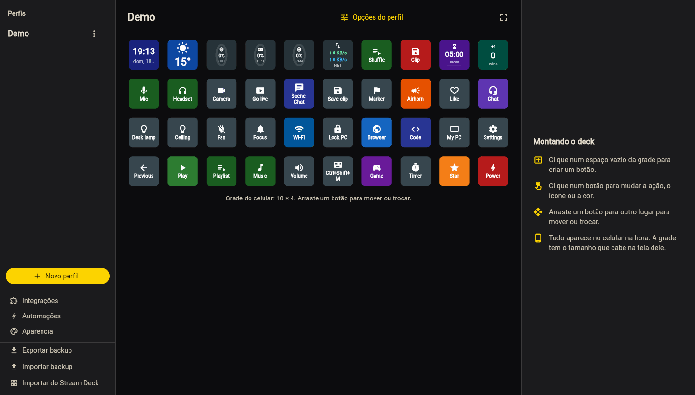

# Configurador

O configurador é o editor dos seus decks. Ele roda no navegador do PC e é servido pelo próprio
DroidDeck — abra-o pela bandeja (**Abrir no navegador**) ou acesse **`http://localhost:4787/`**.

!!! note "Use no próprio PC"
    O configurador só entra automaticamente a partir da mesma máquina (`localhost`). Aberto de outro
    aparelho da rede, o mesmo endereço mostra o [deck no navegador](browser-usb.md#browser), que precisa
    de pareamento.

## Layout

{ .dd-shot width="1440" height="820" loading="lazy" }

A tela tem três painéis:

1. **Perfis**: sua lista de decks. **Novo perfil** cria um; o ícone de lixeira apaga, após confirmação.
2. **Grade**: os botões do perfil selecionado. Clique em uma célula para selecioná-la.
3. **Propriedades**: rótulo, ícone, cores e a ação do botão selecionado. Clique em **Salvar**.

- **Arraste e solte** um botão para movê-lo. Soltar em uma célula ocupada troca os dois de lugar.
- O ícone de lápis renomeia o perfil.
- A barra lateral também abre as **Integrações** e as [Automações](../guide/automations.md), e tem
  **Exportar backup**, **Importar backup** e [Importar do Stream Deck](../guide/import-share.md#stream-deck).

Cada alteração salva é enviada ao celular na hora.

## Tamanho da grade

Quem decide o tamanho da grade é o celular: ele calcula quantos botões (cerca de 96 px cada) cabem na
tela e informa ao PC. Girar o celular atualiza a grade. O configurador mostra a mesma grade, então o
que você edita bate com o que aparece no celular.

## Perfis, páginas e pastas

- No celular, **cada perfil é uma página** — deslize para o lado para trocar.
- Um botão com a ação **Abrir perfil** abre outro perfil como uma **pasta**. Use um botão **Voltar**
  ou a seta de voltar na barra de título para retornar.
- Novos perfis são criados no configurador. Se você não tiver nenhum, um perfil *Default* é criado
  automaticamente.

## Editando no celular

Você também pode editar no próprio celular:

- **Toque** em um botão para executá-lo; **toque e segure** para editá-lo.
- **Toque em uma célula vazia** para criar um botão ali.
- O ícone de engrenagem na barra de título renomeia o perfil.

!!! note "Atalhos de teclado, programas e multiações são editados no PC"
    Botões que enviam teclas ou abrem programas conseguem rodar qualquer coisa no seu PC, por isso só
    podem ser criados ou alterados no configurador, no próprio PC. No celular você continua usando
    esses botões e pode mudar nome, ícone e cor; o editor mostra um cadeado com o que o botão faz.

## Propriedades do botão

| Propriedade | Descrição |
|---|---|
| **Rótulo** | Texto exibido no botão. Botões de mídia e de soundboard o preenchem sozinhos quando vazio. |
| **Ícone** | Um dos ícones embutidos, ou uma imagem personalizada da sua galeria (reduzida para 512×512, guardada no perfil). Um GIF animado vai como está e anima no botão; até 2 MB. |
| **Background Color** | Cor do botão. |
| **Cor ativa** | Cor usada quando o estado do botão está "ligado" (microfone silenciado, lâmpada acesa…). Disponível para ações com estado ao vivo e para botões de dois estados. |
| **Action Type** | O que o botão faz — veja [Botões e ações](../guide/actions.md). |
| **Mostrar no botão** | Mostra um monitor ao vivo ou uma informação (relógio, clima…) — veja [Monitores e informação](../guide/monitors.md). |
| **Dois estados** | Alternar a cada toque, e o rótulo e o ícone quando ativo — veja [Dois estados](../guide/actions.md#two-states). |
| **Tamanho** | Quantas casas o botão ocupa (largura × altura, até 4 × 4) — veja [Tamanho](../guide/actions.md#size). |

## Backup

Use **Exportar backup** na barra lateral para salvar todos os perfis, com as imagens, num único arquivo
`.droiddeck`, e **Importar backup** para trazê-los de volta neste ou em outro PC. O celular também
exporta um. Veja [Backup](../guide/profiles.md#backup).

Por baixo dos panos, os perfis são arquivos JSON em `%AppData%\DroidDeck\Profiles\`; veja
[Arquivos e configurações](../reference/files.md).
