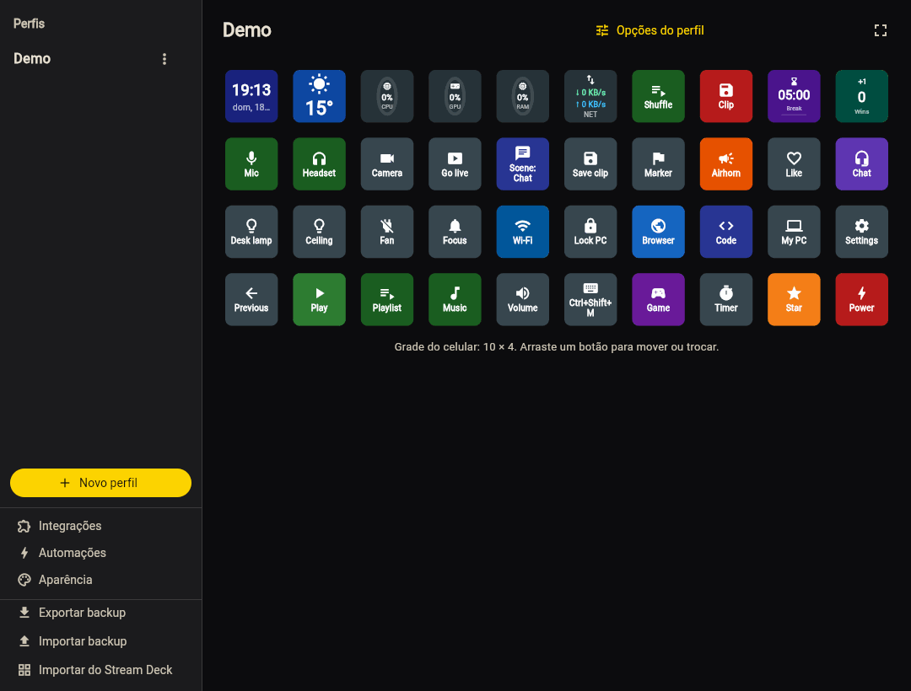
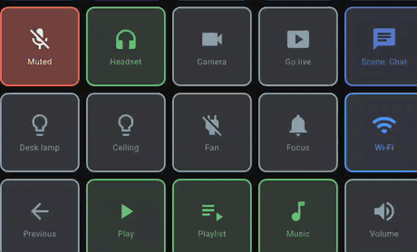

---
hide:
  - toc
---

# Seu primeiro botão

Com o celular [pareado](pairing.md) (o selo no topo do deck mostra **Conectado a** e o nome do seu PC), crie um botão que toca e pausa o que estiver tocando no PC. Leva
um minuto e mostra o ciclo inteiro: edita no PC, toca no celular.

## 1. Abra o configurador

No PC, clique com o botão direito no ícone do DroidDeck na bandeja → **Abrir no navegador** (ou dê
um clique duplo no ícone). O [configurador](configurator.md) abre em `http://localhost:4787/` e entra
sozinho.

<figure class="dd-figure dd-figure--wide" markdown>
[{ .dd-shot width="1080" height="820" loading="lazy" }](../../assets/screenshots/configurator-pt.png)
<figcaption>O configurador com o perfil de demonstração: <strong>Perfis</strong> à esquerda e a
<strong>grade</strong> de botões no meio. Um terceiro painel, à direita, mostra as
<strong>propriedades</strong> do botão selecionado. Clique na imagem para ver a janela inteira.</figcaption>
</figure>

Enquanto nenhum botão está selecionado, o painel da direita é um guia curto:

<figure class="dd-figure" markdown>
{ .dd-shot width="359" height="280" loading="lazy" }
<figcaption>O painel da direita em tamanho real. Clicar numa casa troca este guia pelas propriedades do botão.</figcaption>
</figure>

## 2. Crie o botão

1. Clique numa **casa vazia** da grade. O painel de propriedades mostra um botão novo.
2. Em **Ação**, escolha **Mídia**.
3. Deixe o **Comando** em **Play / Pause**. O **Rótulo** pode ficar vazio: botões de mídia se preenchem
   sozinhos.
4. Clique em **Salvar**.

O botão aparece no celular na hora; não tem nada para sincronizar.

## 3. Toque no celular

Comece uma música ou um vídeo no PC (Spotify, YouTube no navegador, qualquer player) e toque no botão
novo no celular. A reprodução pausa, e o ícone alterna entre ▶ e ⏸ para acompanhar.

Esse é o ciclo inteiro. Botões que têm estado ligado e desligado acendem quando estão ligados, assim:

<figure class="dd-figure" markdown>
{ .dd-shot width="460" height="278" loading="lazy" }
<figcaption>O perfil de demonstração em uso: os botões acendem e trocam o rótulo quando ligam.</figcaption>
</figure>

!!! tip "Prefere editar no celular?"
    Toque numa casa vazia no celular para criar um botão ali, e segure um botão para editá-lo. Botões
    que enviam teclas, abrem programas ou rodam scripts só podem ser criados no PC; veja
    [Configurador](configurator.md#editando-no-celular).

## E agora

- [Botões e ações](../guide/actions.md): todos os tipos de ação, de atalhos de teclado a timers.
- [Integrações](../guide/actions.md#streaming): Discord, OBS, Spotify, lâmpadas inteligentes e mais.
- [Automações](../guide/automations.md): botões que se apertam sozinhos num horário ou quando um app abre.
- [Importar do Stream Deck](../guide/import-share.md#stream-deck): traga seus perfis da Elgato.
- [Galeria de perfis](https://me.gf2.in/DroidDeck/gallery/): decks prontos para começar.
