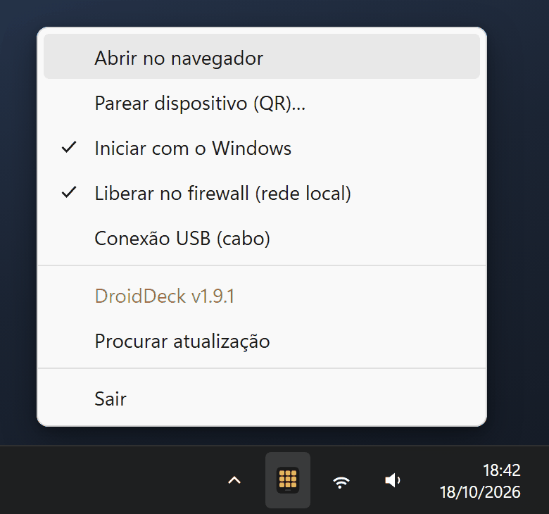

# Instalação

O DroidDeck tem duas partes: o **app para Windows** (servidor) e o **app Android** (o seu deck). Os
dois vêm anexados em toda [release no GitHub](https://github.com/ggfto/DroidDeck/releases/latest).

## Windows

!!! warning "Windows SmartScreen"
    O instalador ainda não tem assinatura de código, então ao executá-lo o Windows pode mostrar
    *"O Windows protegeu o computador"*. Clique em **Mais informações → Executar assim mesmo**.

1. Baixe o **`DroidDeck-Setup.exe`** da release mais recente.
2. Execute. A instalação é por usuário (não pede administrador) e cria atalhos na área de trabalho
   e no menu Iniciar.
3. Na primeira execução, o DroidDeck liga o **Iniciar com o Windows** e oferece liberar o
   [firewall](#firewall) para a rede local. Aceite, para o celular conseguir chegar ao PC.

O app não tem janela. Ele fica na **bandeja do sistema**, e uma notificação confirma que está rodando
em `http://localhost:4787/`. O build é autocontido, então você não precisa instalar o .NET.

O DroidDeck instalado **se atualiza sozinho**: ele procura versões novas nas releases do GitHub,
baixa em segundo plano e aplica a atualização na próxima vez que abrir. Para atualizar na hora, use
**Procurar atualização** no menu da bandeja. Para desinstalar, use *Configurações → Aplicativos* do
Windows.

??? note "Prefere sem instalar?"
    A release também traz o **`DroidDeck-win-x64.zip`**. Extraia em uma pasta definitiva e execute o
    `DroidDeck.exe`. Essa cópia não se atualiza sozinha: o item **Baixar versão mais recente…** da
    bandeja abre a página da release.

### Menu da bandeja

Clique com o botão direito no ícone do DroidDeck na bandeja (ele pode estar atrás da seta **^**):

<figure class="dd-figure" markdown>
{ .dd-shot width="440" height="412" loading="lazy" }
<figcaption>O menu da bandeja. As marcas mostram as opções ligadas.</figcaption>
</figure>

| Item | O que faz |
|---|---|
| **Abrir no navegador** | Abre o configurador em `http://localhost:4787/` (o clique duplo no ícone faz o mesmo). |
| **Parear dispositivo (QR)…** | Mostra o QR code de pareamento para o celular. |
| **Iniciar com o Windows** | Inicia o DroidDeck quando você entra no Windows. |
| **Liberar no firewall (rede local)** | Cria as regras do [firewall](#firewall). Marcado quando elas já existem. |
| **Conexão USB (cabo)** | Conecta um celular Android pelo [cabo USB](browser-usb.md#usb). |
| **Procurar atualização** | Procura uma versão nova e, quando há uma baixada, vira **Reiniciar para atualizar**. |
| **Sair** | Fecha o DroidDeck. |

### Firewall { #firewall }

O celular se conecta ao PC por **TCP 4787**, e a descoberta automática do servidor usa **UDP 7573**.
O jeito mais fácil é o item **Liberar no firewall (rede local)** do menu da bandeja (o instalador
oferece isso na primeira execução). O Windows pede permissão de administrador, e as regras valem
só para aparelhos da sua sub-rede local, mesmo que o Wi-Fi esteja marcado como rede Pública.

Para criar as mesmas regras à mão, use um PowerShell como administrador:

```powershell
New-NetFirewallRule -DisplayName "DroidDeck (TCP 4787)" -Direction Inbound -Protocol TCP -LocalPort 4787 -RemoteAddress LocalSubnet -Action Allow
New-NetFirewallRule -DisplayName "DroidDeck discovery (UDP 7573)" -Direction Inbound -Protocol UDP -LocalPort 7573 -RemoteAddress LocalSubnet -Action Allow
```

## Android

1. No celular, baixe o **`DroidDeck.apk`** da release mais recente.
2. Abra o arquivo e permita a instalação de fontes desconhecidas quando o Android pedir.
3. Abra o **DroidDeck** e siga para o [Pareamento](pairing.md).

É preciso ter Android 7.0 ou mais recente. O app usa a câmera só para ler os QR codes de pareamento.
