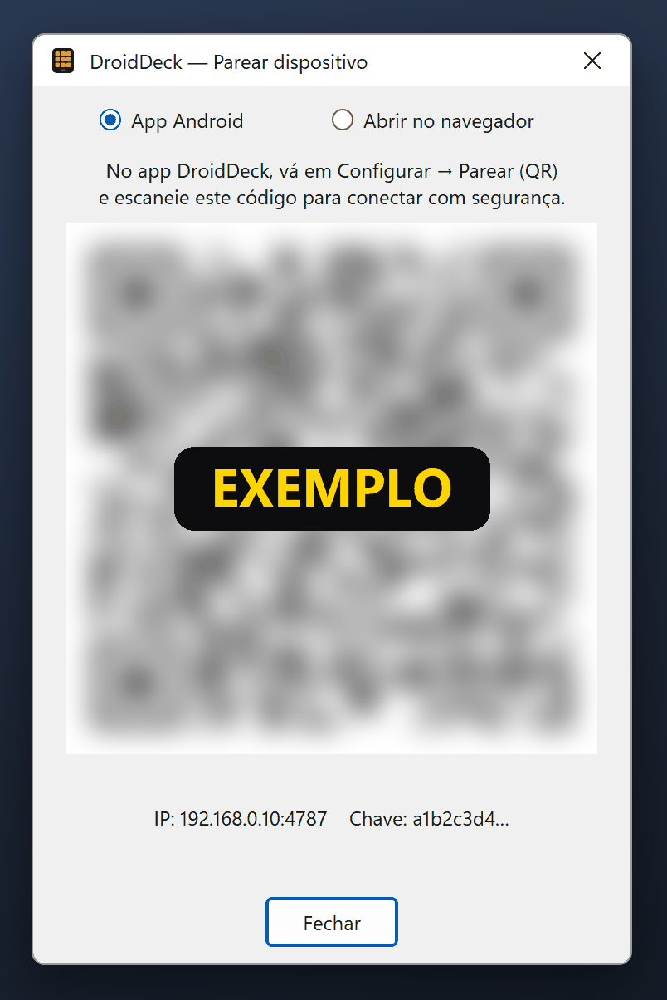

# Pareamento

O pareamento passa ao celular o endereço do PC e uma **chave de API** secreta. Você só faz isso uma vez.

## Parear com QR code (recomendado)

1. No PC, clique com o botão direito no ícone da bandeja e escolha **Parear dispositivo (QR)…**: a
   janela de pareamento abre com **App Android** selecionado.
2. No celular, abra o DroidDeck. Na primeira vez, a tela de **configurações** abre sozinha; nas
   outras, toque na engrenagem da aba **Áudio**.
3. Toque em **Parear (QR)** e leia o código.

<figure class="dd-figure" markdown>
<figcaption>Só um exemplo: o código está borrado de propósito. A sua janela mostra um código nítido,
com o endereço e a chave do seu PC embaixo.</figcaption>
{ .dd-shot width="402" height="602" loading="lazy" }
</figure>

### Conectado { #youre-connected }

O selo de status na barra do topo do deck fica verde e mostra:

:material-link-variant: Conectado a PC-GAMER

com o nome do seu PC no lugar de *PC-GAMER* (pelo cabo USB, o ícone vira um plugue). O celular salva o
endereço, a porta e a chave, e daqui em diante se reconecta sozinho. Se aparecer **Reconectando…** ou
**PC desligado**, veja [Se o celular não conectar](#se-o-celular-nao-conectar).

Próximo passo: [crie o seu primeiro botão](first-button.md).

??? info "O que tem dentro do QR code"
    `droiddeck://pair?ip=<LAN IP>&port=4787&key=<api key>`: o endereço do PC na rede local, a porta
    e a chave de API. Trate-o como uma senha. Quem ler esse código consegue controlar seu PC pelo DroidDeck.

!!! tip "iPhone, iPad ou sem Wi-Fi?"
    Escolha **Abrir no navegador** no topo da mesma janela para um QR code que abre o deck em qualquer
    navegador. Um celular Android também pode se conectar por cabo USB. Veja [Navegador e USB](browser-usb.md).

## Se o celular não conectar

- Confira se o celular e o PC estão na **mesma rede** e se o item **Liberar no firewall (rede local)**
  da bandeja está marcado.
- Se o celular mostrar *"Falha de autenticação (chave inválida ou expirada). Refaça o pareamento."*,
  leia o QR code de novo.
- Mais soluções em [Solução de problemas](../troubleshooting.md).

## Outras formas de conectar

### Encontrar o servidor automaticamente

**Pesquisar Servidor** faz um broadcast na rede local (UDP 7573) e preenche o IP do PC. A descoberta
**não** envia a chave de API, então você ainda precisa parear com o QR code antes que o celular
consiga se conectar.

### Digitar o endereço manualmente

Digite o IP do PC em **IP do Servidor** (`192.168.0.10` ou `192.168.0.10:4787`) e toque em **Salvar**.
A chave de API de um pareamento anterior é mantida.

## Trocar a chave

A chave fica guardada no PC em `%LocalAppData%\DroidDeck\apikey`. Para revogar o acesso de todos os
celulares pareados, feche o DroidDeck, apague esse arquivo e abra-o de novo. Uma nova chave é gerada,
e todos os celulares precisam parear outra vez.

??? note "Comportamento da conexão"
    O celular se reconecta sozinho se o PC reiniciar ou o Wi-Fi cair. No começo ele tenta de novo
    rapidamente (0, 2, 5, 10, 20 s) e depois a cada 30 s, indefinidamente. Toque no selo de status
    para ver o que fazer e, em **Detalhes técnicos**, a URL de conexão (com a chave mascarada) e os últimos dados recebidos.
