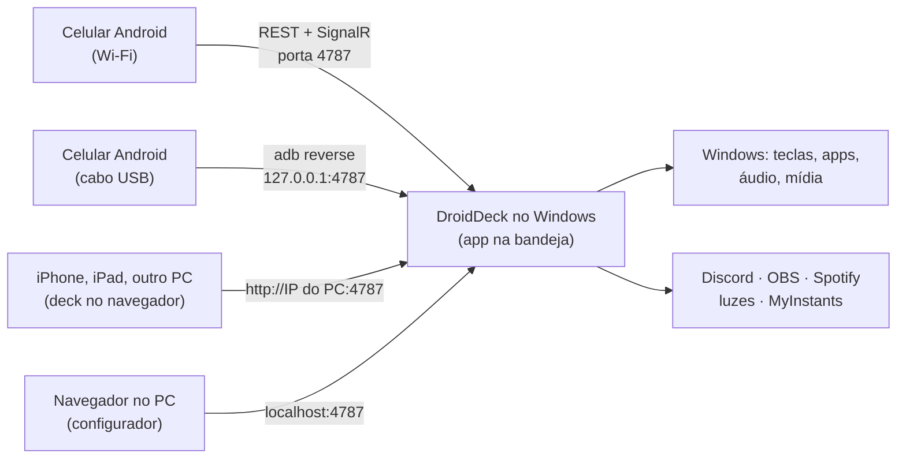

# DroidDeck

**O DroidDeck transforma um celular Android em um Stream Deck para o seu PC com Windows.** Monte uma
grade de botões no celular que disparam atalhos, abrem apps, controlam áudio e mídia, comandam o
Discord e o OBS, tocam sons e acendem suas lâmpadas inteligentes. No PC roda um pequeno app na
bandeja do sistema; o celular conversa com ele pela rede local.

[Baixar a versão mais recente :material-download:](https://github.com/ggfto/DroidDeck/releases/latest){ .md-button .md-button--primary }
[Começar](getting-started/installation.md){ .md-button }

<figure class="dd-figure dd-figure--wide" markdown>
{ .dd-shot width="960" height="410" }
</figure>

!!! info "Procurando o app que roda Steam no Android?"
    É outro projeto, que tem o mesmo nome:
    [Droid-Deck/DroidDeck](https://github.com/Droid-Deck/DroidDeck). Este DroidDeck é um painel de
    botões que controla um PC com Windows.

## O que dá para fazer

-   :material-keyboard: **Comandar o PC**

    Combinações de teclas, programas, arquivos e URLs, scripts do PowerShell/Python/`.bat`, webhooks,
    jogos da Steam, e o próprio Windows: áudio padrão, travar, suspender, desligar a tela.
    [Botões e ações](guide/actions.md) · [Multiação](guide/multi-action.md)

-   :material-volume-high: **Áudio e mídia**

    Tocar/pausar e pular o que o Windows estiver tocando, silenciar apps, controles de volume, Spotify
    com a capa do álbum, Voicemeeter e um soundboard do MyInstants no seu microfone.
    [Mixer e mídia](integrations/mixer-media.md) · [Soundboard](integrations/soundboard.md)

-   :simple-obsstudio: **Streaming**

    Voz e soundboard do Discord, cenas, gravação e transmissão do OBS com estado ao vivo, marcadores,
    clipes, enquetes e chat da Twitch e do YouTube, Streamer.bot e VTube Studio.
    [Discord](integrations/discord.md) · [OBS](integrations/obs.md)

-   :material-lightbulb-on: **Luzes e casa inteligente**

    Tuya / Smart Life, Home Assistant, Philips Hue, Elgato Key Light, Govee e MQTT: liga/desliga,
    dimmer e cores, com o estado real no botão.
    [Tuya](integrations/tuya.md) · [Home Assistant](integrations/homeassistant.md)

-   :material-chart-donut: **Informação ao vivo**

    Medidores de CPU, GPU, RAM e rede, relógio, clima, tocando agora, notificações do Windows, timers e
    pomodoro, botões de dois estados, botões grandes e ícones em GIF animado.
    [Monitores e informação](guide/monitors.md) · [Aparência](guide/appearance.md)

-   :material-folder-multiple: **Perfis e automação**

    Pastas, toque longo e toque duplo, troca pelo app em foco, automações, importação do Stream Deck,
    compartilhamento por link ou QR, e o deck em qualquer navegador ou pelo USB.
    [Perfis](guide/profiles.md) · [Automações](guide/automations.md)

## Como funciona

1. **O DroidDeck para Windows** roda na bandeja do sistema e serve uma API, o configurador web e o deck
   no navegador na porta `4787`.
2. **O app Android** é pareado uma única vez lendo um QR code e depois mostra seus botões em tela cheia,
   pelo Wi-Fi ou por um [cabo USB](getting-started/browser-usb.md#usb).
3. **O configurador** roda no navegador do PC: arraste botões, escolha ações, cores e ícones.
   As alterações aparecem no celular na hora.

## Requisitos

- Windows 10 versão 1809 ou mais recente (64 bits). Não precisa instalar o .NET.
- Android 7.0 ou mais recente. Ou, pelo [navegador](getting-started/browser-usb.md#browser), um iPhone,
  iPad ou qualquer aparelho com um navegador moderno.
- Celular e PC na mesma rede local, ou um celular Android num [cabo USB](getting-started/browser-usb.md#usb).

!!! note "Idioma"
    O app segue o idioma do celular (português, inglês ou espanhol); dá para trocar em **Configuração →
    Aparência → Idioma**. Esta documentação está em português e em inglês (use o seletor de idioma no
    topo); ainda não há versão em espanhol.
