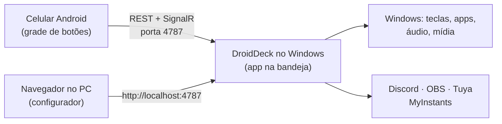

# DroidDeck

**O DroidDeck transforma um celular Android em um Stream Deck para o seu PC com Windows.** Monte uma
grade de botões no celular que disparam atalhos, abrem apps, controlam áudio e mídia, comandam o
Discord e o OBS, tocam sons e acendem suas lâmpadas inteligentes. No PC roda um pequeno app na
bandeja do sistema; o celular conversa com ele pela rede local.

!!! info "Procurando o app que roda Steam no Android?"
    É outro projeto, que tem o mesmo nome:
    [Droid-Deck/DroidDeck](https://github.com/Droid-Deck/DroidDeck). Este DroidDeck é um painel de
    botões que controla um PC com Windows.

[Baixar a versão mais recente :material-download:](https://github.com/ggfto/DroidDeck/releases/latest){ .md-button .md-button--primary }
[Começar](getting-started/installation.md){ .md-button }

## O que dá para fazer

| | |
|---|---|
| :material-keyboard: **Atalhos e apps** | Envie combinações de teclas, abra programas, arquivos e URLs, rode scripts do PowerShell/Python/`.bat`, chame webhooks, encadeie passos em uma multiação com condições. |
| :material-microsoft-windows: **Windows** | Troque o dispositivo de áudio padrão, trave o PC, suspenda, desligue a tela. |
| :material-volume-high: **Mixer de áudio** | Silencie apps, ajuste o volume de dispositivos, ligue e desligue o microfone. O celular também tem um mixer completo por app. |
| :material-play-pause: **Mídia** | Tocar/pausar, próxima e anterior para o que estiver tocando no Windows (Spotify, navegador, players). |
| :material-chart-donut: **Monitores ao vivo** | Medidores de CPU, GPU, RAM e rede atualizados a cada segundo. |
| :simple-discord: **Discord** | Silenciar/ensurdecer, entrar em canais, volume de voz, push-to-talk, volume por usuário, soundboard nativo. |
| :simple-obsstudio: **OBS Studio** | Cenas, gravação, transmissão, câmera virtual, replay buffer, fontes, filtros e capturas de tela, com estado ao vivo. |
| :material-timer-outline: **Timers** | Timer, cronômetro, pomodoro e contadores com o relógio ao vivo no botão. |
| :simple-steam: **Steam** | Escolha um jogo instalado e o botão ganha a capa dele; um toque abre o jogo. |
| :material-folder-multiple: **Perfis** | Pastas, ações de toque longo e toque duplo, troca automática pelo app em foco, backup e uma cópia offline do deck. |
| :material-music-box-multiple: **Soundboard** | Busque e toque sons do MyInstants, enviados ao seu microfone pelo VB-Cable. |
| :material-lightbulb-on: **Casa inteligente** | Home Assistant, e lâmpadas, tomadas e interruptores Tuya / Smart Life — liga/desliga, dimmer e cores, com estado real. |
| :simple-spotify: **Spotify** | Player, curtir, aleatório, playlists e a capa do álbum no botão (Premium). |
| :simple-twitch: **Twitch e YouTube** | Marcadores, clipes, anúncios, enquetes e chat; ao vivo e espectadores. |
| :material-toggle-switch: **Dois estados e informação** | Botões liga/desliga com ícone e rótulo próprios, e relógio, clima, tocando agora, notificações do Windows, saída de comando e valores de URL. |
| :material-tune-vertical: **Controles deslizantes e botões grandes** | Controles de volume do PC, do microfone ou de um app; botões que ocupam várias casas; ícones em GIF animado. |
| :material-puzzle: **Mais integrações** | [Streamer.bot](integrations/streamerbot.md), [VTube Studio](integrations/vtubestudio.md), [Voicemeeter](integrations/voicemeeter.md), [Philips Hue](integrations/hue.md), [Elgato Key Light](integrations/elgato.md), [Govee](integrations/govee.md) e [MQTT](integrations/mqtt.md), na sua rede local. |
| :material-robot: **Automações** | Um botão apertado sozinho num horário, quando um app abre ou fecha, ou quando o PC volta da suspensão. |
| :material-import: **Importar e compartilhar** | Importe perfis do Stream Deck da Elgato, compartilhe um perfil por link ou QR, comece pela galeria de perfis. |
| :material-cellphone-link: **Qualquer aparelho** | Use o deck no navegador de um iPhone, iPad ou outro PC, ou conecte um celular Android pelo USB, sem Wi-Fi. |

## Como funciona

1. **O DroidDeck para Windows** roda na bandeja do sistema e serve uma API e o configurador web na porta `4787`.
2. **O app Android** é pareado uma única vez lendo um QR code e depois mostra seus botões em tela cheia.
3. **O configurador** roda no navegador do PC: arraste botões, escolha ações, cores e ícones.
   As alterações aparecem no celular na hora.

## Requisitos

- Windows 10 versão 1809 ou mais recente (64 bits). Não precisa instalar o .NET.
- Android 7.0 ou mais recente — ou, pelo [navegador](getting-started/browser-usb.md#browser), um iPhone,
  iPad ou qualquer aparelho com um navegador moderno.
- Celular e PC na mesma rede local, ou um celular Android num [cabo USB](getting-started/browser-usb.md#usb).

!!! note "Idioma"
    O app segue o idioma do celular (português, inglês ou espanhol); dá para trocar em **Configuração →
    Aparência → Idioma**. Esta documentação está disponível em português e em inglês — use o seletor de
    idioma no topo.
